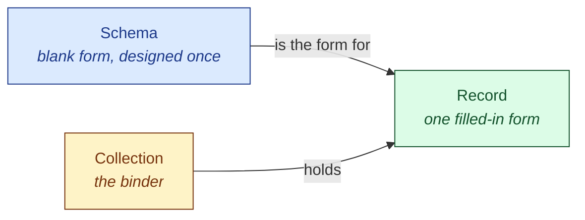
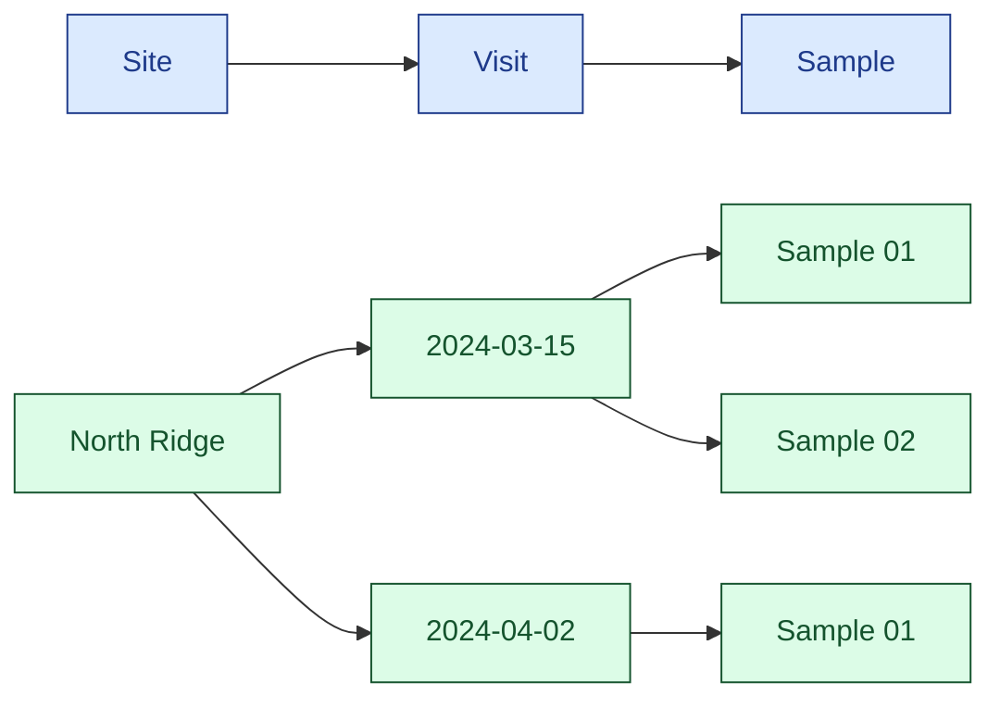

# Schemas, collections and records

Three ideas carry everything in civex. People new to it mix up the first and
the last, so here they are in plain words before anything else.

Schema &nbsp; Collection &nbsp; Record

These colours are used wherever the docs name the three.

## A blank form, a binder, a filled-in form

**A schema is a blank form.** When you design the form you
decide the boxes (**fields**) and what is allowed in each box (**rules**): "Depth,
a number, in metres, not below 0". You design it once.

**A record is one filled-in copy of that form.** Every time you
have another sample, you fill in a new copy. You don't redesign the form.

**A collection is the binder the filled-in forms go in.** It
says which schemas may go in it, and that's all it does. One per study,
site or season, as suits you.

| | How many | Looks like | Made where |
|---|---|---|---|
| Schema | A handful per project | *Sample*, *Site*, *Visit* | **New ▸ New schema…** in a collection, then **+ Add field** on the record. **Schemas** in the sidebar shows them all |
| Collection | One per study or season | *survey-2024* | **Collections → New collection** |
| Record | Hundreds or thousands | *Sample 03*, *North Ridge* | Inside a collection: **New ▸ Sample** |

## Which one do I want?

Ask yourself about the thing you're about to create:

- Can you say "**a** ___"? "A sample", "a site", "a visit". That is a
  schema. You will have a few of them in the whole project.
- Is it "**this** ___"? "Sample 3", "the North Ridge site", "the visit on 15 March".
  That is a record. You will have hundreds.
- Does it have the **same boxes** as something you already have? Then you want
  a new record of that type, not a new type.

!!! warning "If you're making a new schema every time you add data, stop"
    You want **New ▸ Sample** inside your collection.
    A schema is the form, not the data. A project with one schema per
    measurement has no way to list, filter or export them together; a project with
    one *Sample* type and five hundred sample records does.

## Types that go inside other types

A schema can be designed to sit **inside** another: a *Visit* goes inside
a *Site*, a *Sample* goes inside a *Visit*. Then every sample record you add is
filed under the visit it belongs to, and can show and filter on the visit's
and the site's fields without you typing them again.

The top row is the three schemas. Everything below is records. Where you
press **New** decides the nesting: **New ▸ New schema…** inside a site
makes a kind that goes inside sites. It can't be moved later.

## The same example everywhere

The rest of the docs use this one example, a field survey:

| Schema | Its fields | Goes inside |
|---|---|---|
| Site | name, location | — |
| Visit | visited on, team, notes | Site |
| Sample | number, depth (m), taken at, photo, reading | Visit |

Collection: survey-2024. Records look like
North Ridge › 2024-03-15 › Sample 03.

**Next:** [Five-minute tour →](tour.md)
