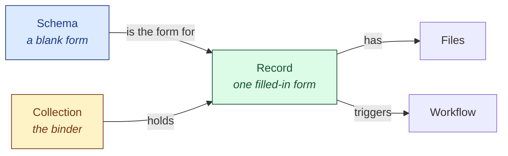

# Civex

Civex keeps research data in order on your own computer: typed records, the files
that belong to them, and workflows that process them. No cloud service and no
database administrator are needed. Use it from the web app or the command line.

## Start here

1. [Install](getting-started/install.md)
2. [Your first project](getting-started/first-project.md)
3. [Schemas, collections and records](getting-started/concepts.md), the three ideas
4. [Five-minute tour](getting-started/tour.md)

## I want to…

| | Guide |
|---|---|
| Bring in a folder of files | [Import files](how-to/import-data.md) |
| Fill fields from file names automatically | [Fill fields from file names](how-to/fill-fields-from-filenames.md) |
| Keep files on an external or network drive | [Put files on another drive](how-to/storage-drives.md) |
| Hand over files as a folder, zip or table | [Get files out](how-to/export-files.md) |
| Work on the same project from several computers | [Sync a project](how-to/set-up-sync.md) |
| Put back something changed or deleted | [Undo a mistake](how-to/undo-mistakes.md) |
| Back up a project | [Back up a project](how-to/back-up.md) |

## The pieces

| | What it is | Example |
|---|---|---|
| Schema | A blank form: the fields one kind of thing has, designed once. Called a *schema* in the CLI and API. Types can go inside other types | Site › Visit › Sample |
| **Field** | One box on the form, with a type and rules | `depth` (number, in m), `photo` (file) |
| Collection | The binder: holds records of any schema | `survey-2024` |
| Record | One filled-in form: this site, this sample | *North Ridge › 2024-03-15 › Sample 03* |
| **Volume** | A folder or drive where files are stored | `_civex/objects`, `/media/archive` |
| **Workflow** | YAML steps that run when records change | read a time from a file name |
| **Authority** | The civex other computers sync with | `https://lab-pc.tail1234.ts.net` |

The same survey example runs through every page. The
[guides](guides/schemas-and-fields.md) explain each piece in depth, and the
[reference](reference/cli/index.md) lists every command and endpoint.
